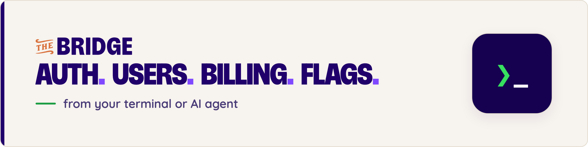

<p align="center">
  <a href="https://thebridge.dev/?utm_source=npm&utm_medium=readme&utm_campaign=bridge-cli"><picture><source media="(prefers-color-scheme: dark)" srcset="https://raw.githubusercontent.com/thebridgedev/bridge-cli/main/.github/assets/banner.png"></picture></a>
</p>

# The Bridge CLI 1.0 (alpha)

`@nebulr-group/bridge-cli` sets up your app on Bridge from the terminal. You sign in, then create your app and its addresses, its keys, plans with prices and trials, Stripe in test mode, and the feature flags your code gates on. It works the same for you and for a coding agent: every result is JSON.

> **This is the 1.0 alpha.** It talks to version 2 of Bridge's API only. For the Bridge you use today, stay on 0.x: `npm install -g @nebulr-group/bridge-cli` installs it (`latest`).

## Install

```bash
npm install -g @nebulr-group/bridge-cli@alpha
# or, without installing
npx @nebulr-group/bridge-cli@alpha --help
```

It needs Node.js 20 or later.

## Sign in

The CLI needs one address: your **issuer**, the address Bridge signs you in at. Every other endpoint is read from the issuer's published metadata. Give it once; it is saved for the commands that follow.

```bash
bridge auth login --issuer https://<your Bridge>/identity-access/apps/<app id>
```

This opens Bridge's sign-in page in your browser. You sign in there, and the browser comes back to the CLI on `127.0.0.1`. The sign-in is bound to this process with PKCE, so a code that leaks is no use to anyone else. If the browser cannot be opened, the CLI prints the address to open.

If no browser is at hand (a server, a container, CI), sign in in the terminal:

```bash
bridge auth login --password --email you@example.com          # asks for the password, without echo
echo "$PASSWORD" | bridge auth login --password --email you@example.com --password-stdin
```

If you belong to several workspaces, the CLI asks which one, or takes `--workspace <id>`.

```bash
bridge auth whoami              # who you are, which workspace, which app commands act on
bridge auth workspace           # your workspaces
bridge auth workspace <id>      # switch to one
bridge auth logout              # ends the session at Bridge and removes it from this machine
```

**Where the session is kept.** In your operating system's keychain (the macOS keychain, or the Secret Service keyring on Linux) when there is one, else in `~/.config/bridge/v1/sessions.json`, readable only by you (mode 0600). Set `BRIDGE_TOKEN_STORE=file` to use the file. The CLI renews the session as it goes; each renewal replaces the refresh token, and the old one stops working.

## Set up an app

```bash
# 1. Create the app. Commands act on it from now on (`bridge app use <id>` switches).
bridge app create --name "My App" \
  --sign-in-return http://localhost:5173/auth/callback \
  --email-links http://localhost:5173/auth/link \
  --browser-origin http://localhost:5173

# 2. Add your production addresses next to the development ones.
bridge app address add https://myapp.com/auth/callback --use sign-in-return
bridge app address add https://myapp.com --use browser-origin
bridge app address list

# 3. A key for your server. The secret is shown once: put it in your server's secrets.
bridge key create --name "production server"

# 4. Plans: prices, a trial, a per-unit usage price, features and limits.
bridge metric set exports --kind counter --name "Exports"
bridge plan create pro --name Pro \
  --price "19 EUR/month" --price "190 EUR/year" \
  --usage-price "exports 0.05 EUR/month included 100" \
  --trial-days 14 \
  --feature analytics --limit seats=10

# 5. Take payments: connect Stripe in test mode with your test secret key (asked for without echo).
bridge stripe connect

# 6. Flags: every gate in your code is a flag, and its rule says who gets it.
bridge flag create analytics --when "bridge:billing.entitlement.analytics eq true"
bridge flag create team-admin --when "privileges contains USER_WRITE"
```

## Commands

| Command | What it does |
|---|---|
| `auth login` · `logout` · `whoami` · `workspace` | Sign in and out, see who you are, switch workspace |
| `app list` · `create` · `use` · `get` · `update` · `delete` | Your apps; `update` sets the name, logo, website, privacy policy and terms |
| `app address list` · `add` · `remove` | Sign-in returns, email links, browser origins, sign-out and checkout returns |
| `app default-return <url>` | The sign-in return used when a sign-in names none |
| `key list` · `create` · `revoke` | App keys, for your server |
| `plan list` · `get` · `create` · `update` · `apply` · `archive` · `delete` | Plans as one document; `apply <file>` creates or replaces one from JSON |
| `plan price` · `usage-price` · `feature` · `limit` (`set`/`add`, `remove`) | Change one entry of a plan |
| `product` · `metric` · `tax` · `billing settings` | Add-ons, what you count, tax rates, billing settings |
| `stripe status` · `connect` · `disconnect` | Stripe, in test mode by your pasted test key |
| `flag list` · `get` · `create` · `update` · `on` · `off` · `restore` · `delete` | Feature flags |
| `flag rule show` · `add` · `set` · `clear` | A flag's rule: ordered branches of conditions, the first match wins |
| `role` · `privilege` · `workspace list` · `member` | Roles, privileges, your customers' workspaces and their members |
| `check gates` | Lists every direct role, privilege or plan check in your project, with the flag to use instead |

`bridge <command> --help` has every option.

### Prices

Write prices the way you say them: `"19.99 EUR/month"`, `"190 EUR/year"`, or `"49 EUR"` for a one-time product. A usage price is a price per unit on top of a plan's price: `"api.calls 0.002 EUR/month included 10000"` charges 0.002 EUR per call above 10,000 a month. Limits are `metric=n` or `metric=unlimited`.

### Flag rules

`--when "<attribute> <operator> <value>"` writes a one-branch rule; repeat `--when` to require every condition. The operators are `eq`, `neq`, `contains`, `not_contains`, `in`, `not_in`, `gt`, `lt`, `between`, `regex`, `exists` and `not_exists`. `flag rule add` adds a branch, `--rollout 25` gives it to a share of the people it matches, and `--rule`/`--rule-file` take a whole rule as JSON.

### Roles, members and the pasted Stripe key

Bridge offers roles, privileges, workspaces, members and a pasted Stripe key to your app's own server, so these commands call Bridge with an app key. Set `BRIDGE_APP_KEY` to one of your app's keys, or leave it unset: the CLI then makes a key that lasts one day and holds only what the command needs, and revokes it as soon as the command is done. Making a key needs a recent sign-in; if yours is older, the CLI says so.

## Output

Results are JSON on stdout: `{ "success": true, "data": … }`. Errors are JSON on stderr: `{ "success": false, "error": { "code", "message", "hint" } }`. Messages meant for you go to stderr as plain text.

Exit codes: `0` done, `1` refused or failed, `2` Bridge could not be reached or could not answer, `3` the CLI is not set up (no issuer, not signed in, a wrong setting).

## Settings

| Variable | Flag | What it is |
|---|---|---|
| `BRIDGE_ISSUER` | `--issuer` | Your issuer. Saved at sign-in |
| `BRIDGE_APP` | `--app` | The app commands act on. Default: the one chosen with `bridge app use` |
| `BRIDGE_SIGN_IN_PAGE` | `auth login --sign-in-page` | Bridge's sign-in page, when the issuer does not list it |
| `BRIDGE_APP_KEY` | | An app key for the commands that need one |
| `BRIDGE_TOKEN_STORE` | | `file` to keep the session in the 0600 file, `keychain` to require the keychain |
| `BRIDGE_CONFIG_DIR` | | Where settings are kept. Default `~/.config/bridge/v1` |

## Security

- The issuer and every endpoint must be `https`; plain `http` only on `localhost`, `127.0.0.1` and `[::1]`, for local development.
- The CLI never follows a redirect, so your token goes only to the addresses your issuer lists.
- Browser sign-in listens on `127.0.0.1` only, checks the `state` it sent and the issuer the page names, and uses PKCE (S256).
- Passwords and Stripe keys are read without echo or from stdin, never from arguments, and never kept.

## Use it from code

Every command is a plain function over one client, exported from the package:

```ts
import { BridgeClient, Sessions, FileStore, discover, plans } from '@nebulr-group/bridge-cli';
```

## License

MIT
